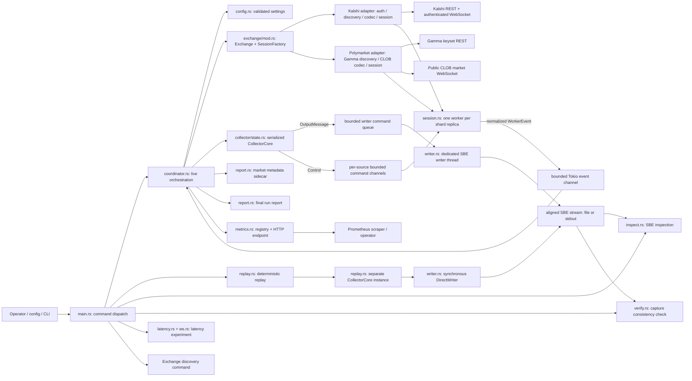
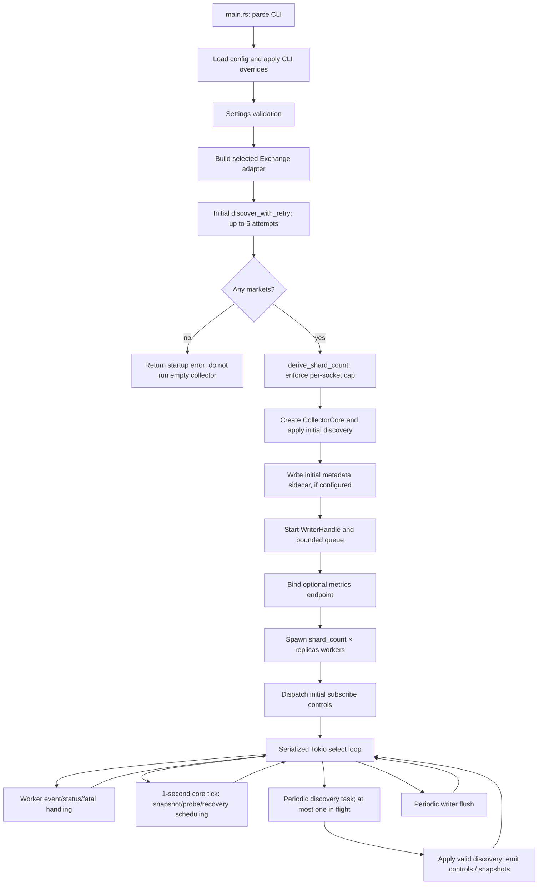
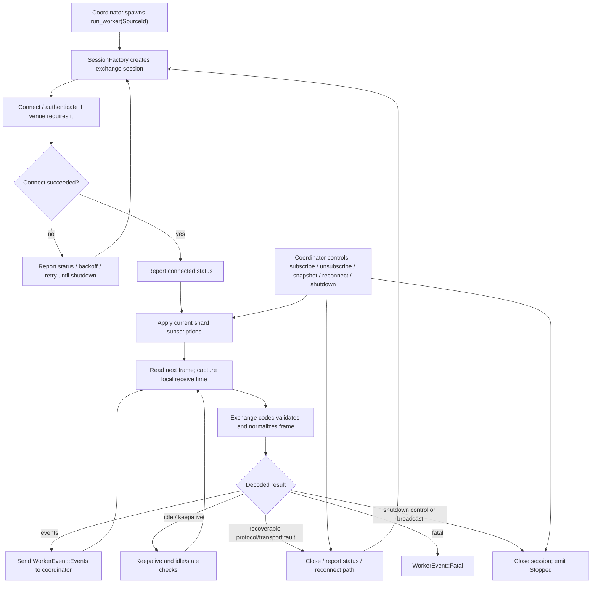
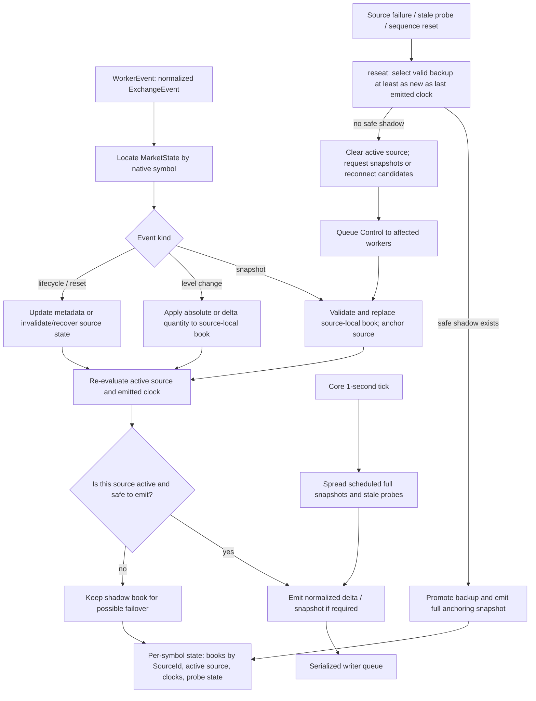
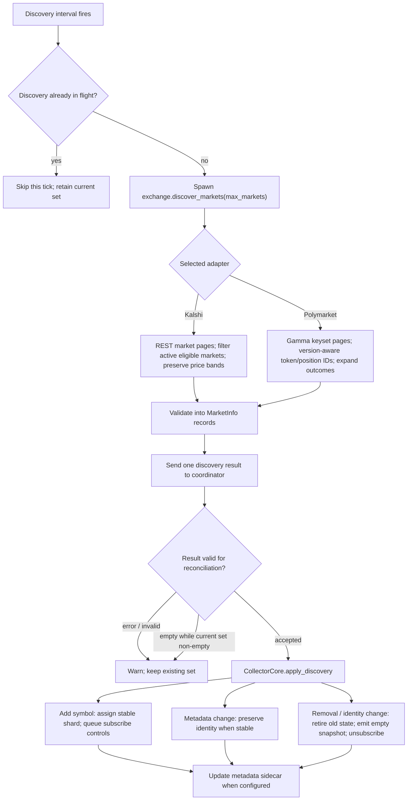
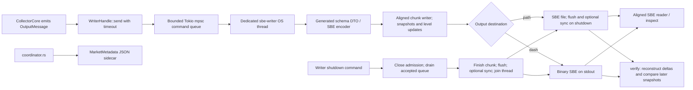
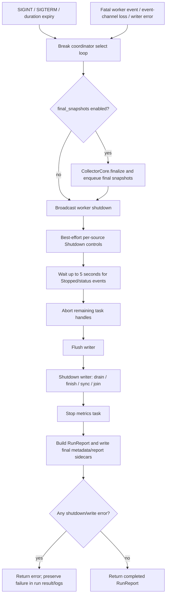

# End-to-end architecture and traceability

**Architecture contract for the audited implementation:** `phase1/correctness-audit`, commit `8725c213503fb1a1f4adc1b3b3a0854a5dd1ba31` (2026-10-26). This document describes code that exists at that revision. It is not a design for the proposed Phase 2 hardening work. If the active branch moves, regenerate the inventories and review every changed edge before treating this document as current.

This is deliberately a set of linked views rather than one unreadable mega-graph. The arrows describe control or data flow; node labels name the main implementation boundary. Paths and test symbols below make material claims auditable against the repository.

## 1. System topology — runtime components and boundaries



**Ownership rule.** `coordinator.rs` owns the serialized `CollectorCore` and makes the decisions that mutate books and produce outputs. Source workers own their websocket session and exchange-specific protocol state. The writer thread is the only live-collection owner of the SBE sink. Worker tasks do not write SBE directly. This prevents concurrent writes from reordering records outside the coordinator's processing order.

**Data contracts.** Exchange-specific codecs map venue frames to normalized types in `model.rs`: `MarketInfo`, `ExchangeEvent`, `EventMeta`, `SourceId`, `Control`, and `OutputMessage`. `fixed.rs` and `side.rs` supply normalized price/side semantics; `orderbook.rs` implements the normalized book; generated SBE DTOs and the aligned reader/writer adapt the supplied schema.

## 2. Startup and steady-state orchestration



Startup ordering is material: **initial discovery finishes before workers start**. Failures are retried with exponential waits by `discover_with_retry`; an empty initial result is rejected. When automatic sharding (`shards = 0`) is configured, the number of shards is derived from the discovered symbol count, bounded by `max_shards`, and checked against `max_symbols_per_socket`. Explicit shard counts are checked against the same per-socket limit.

During steady state the main loop serializes every `CollectorCore` mutation. Discovery pagination runs in a spawned task so it does not itself hold the event loop while making REST calls. The `discovery_in_flight` flag and one-slot result channel prevent overlapping discovery tasks. A failed, invalid, or empty discovery result when symbols are already active preserves the current subscription set rather than treating the result as authoritative deletion.

## 3. WebSocket worker and adapter lifecycle



The shared contract is `MarketDataSession` + `SessionFactory` in `session.rs`; `run_worker` owns retry, control handling, status reporting and shutdown behavior. The adapter is responsible for venue protocol details. Kalshi signs authenticated requests, reconciles subscriptions, tracks per-subscription sequence numbers and treats a sequence gap as a recovery event. Polymarket uses public CLOB market messages; its decoder treats `book` as a snapshot and `price_change` sizes as absolute level sizes. Polymarket has no exchange sequence number in this adapter, so protocol faults are recovered by reconnecting/resubscribing to obtain fresh books.

The local receive timestamp is captured on frame read before decoding and carried in `EventMeta`. Do not infer a global exchange chronology from it: the writer preserves coordinator processing order, and cross-symbol timestamps can regress.

## 4. Book state, shadow replicas, and recovery



The core tracks a separate `SourceBook` per source for a symbol; replicas are shadow books, not duplicate outputs. A source switch is safe only when `best_backup` finds a usable book meeting the last emitted exchange-clock boundary when that clock exists. The core emits a snapshot before resumed deltas to create a consumer-side anchor. If no candidate is safe, it drops the active assignment for that symbol and asks healthy candidates for fresh snapshots or reconnects stale/behind candidates. Clock regressions and reset events are handled as recovery/epoch boundaries, not silently clamped to monotonic timestamps.

A full snapshot is emitted periodically (default 60 seconds, spread across symbols) and at relevant state boundaries such as initial anchoring, failover/recovery, symbol retirement, and finalization. Periodic snapshot scheduling uses the one-second core tick; snapshot interval is configurable.

## 5. Discovery and symbol-set reconciliation



The two venue adapters share the `Exchange::discover_markets` boundary but have different source protocols and validation rules. Kalshi discovery retains the full authoritative `price_ranges` grid when supplied. Polymarket discovery follows Gamma keyset cursors, rejects repeated cursors, applies market eligibility filters, and selects identifiers according to the market protocol version. Output symbols are namespaced and designed to stay stable across title/slug edits.

**Current operational caveat:** the initial full discovery is synchronous from the caller's perspective and completes before workers start. Later discovery is off the main event loop, but an accepted result still causes metadata-sidecar serialization/write from the coordinator path. The configured discovery interval is a polling cadence, not a guarantee that a full REST sweep completes within that cadence.

## 6. Output, SBE layout, sidecars, and consumers



One writer preserves the order in which the coordinator enqueues messages; it does **not** sort records by timestamp. The command queue is bounded and sends use a timeout, so prolonged writer backpressure becomes an error instead of unbounded queue growth. Flushes are periodic; shutdown closes admission, drains already-accepted messages, finishes the final chunk, flushes, optionally syncs a file, and joins the writer thread. The supplied SBE schema is the compatibility boundary; `src/util/build.rs` generates the codec/DTO integration from the schema at build time.

`inspect` provides an offline SBE view. `verify` checks capture self-consistency by applying deltas and comparing reconstructed books with subsequent snapshots. It is not an oracle for every missed live update: a missed event is detectable only when later observations expose the mismatch.

**Current operational caveats:** a file sink is created through `File::create` in the aligned writer path, which truncates an existing path; output rotation/retention is not implemented in this revision. Protect capture paths operationally until non-destructive output creation and rotation are implemented and tested.

## 7. Shutdown and fatal-error convergence



Final snapshots are generated before shutdown is broadcast. During the bounded worker wait, post-final data events are intentionally suppressed, while final status events can still update report state. A writer or finalization failure is retained as a shutdown error and returned instead of being silently reported as success. The writer's own shutdown path uses queue closure plus thread join to terminate even when the queue was saturated.

## 8. CLI modes and verification planes

```mermaid
flowchart TD
    CLI["main.rs / clap"] --> Collect["collect: coordinator + workers + live writer"]
    CLI --> Discover["discover: one-shot Exchange discovery; JSON / stdout"]
    CLI --> Replay["replay: JSONL fixture/input -> same collector core -> DirectWriter"]
    CLI --> Inspect["inspect: SBE reader -> summary JSON"]
    CLI --> Verify["verify: SBE reader -> delta/snapshot self-consistency"]
    CLI --> Latency["latency: configured connection experiment -> JSON / markdown evidence"]
    Collect --> LiveNet["Live exchange REST/WebSocket"]
    Discover --> Rest["Exchange REST endpoint"]
    Replay --> Fixture["fixtures/sample_replay.jsonl or user input"]
    Inspect --> Capture["SBE capture"]
    Verify --> Capture
    Latency --> PublicNet["Public WebSocket endpoint"]

    CI["GitHub Actions CI"] --> Format["cargo fmt check"]
    CI --> Lint["cargo clippy -D warnings"]
    CI --> Tests["cargo test --all-targets + doc tests"]
    CI --> Build["cargo build --release"]
    E2E["Mock-exchange E2E"] --> RealPath["Real coordinator / adapter / session / writer / reader"]
    Live["Opt-in live Polymarket tests"] --> LiveNet
```



The test strategy has separate assurance planes:

- Unit tests exercise fixed-point arithmetic, order-book transitions, venue codecs/discovery, sequence recovery, sharding/failover, metrics, reports and writer fault paths.
- `tests/e2e_mock_exchange.rs` runs a loopback mock REST/WebSocket exchange through the real coordinator and Polymarket path; the mock's independently recorded delivered-update history is the event-completeness oracle for that test.
- `tests/replay_fixture.rs` confirms a deterministic JSONL fixture follows the same core/output/reader path.
- `tests/live_polymarket.rs` is ignored unless explicitly enabled. A successful short public run is not proof of full-universe live capacity or long-term completeness.

## 9. Repository-level artifacts and configuration contracts

| Artifact | Role in the executable system | Sync requirement |
|---|---|---|
| `Cargo.toml` / `Cargo.lock` / `rust-toolchain.toml` | Dependency graph, reproducible dependency resolution, pinned compiler/toolchain | Build and lint gates must use the lockfile and pinned toolchain |
| `sbe_schemas/engineering_challenge/challenge_orderbook.yaml` and `sbe_schemas/includes/common-types.xml` | Authoritative SBE wire schema and shared schema types | Schema changes require codec/read-write compatibility evidence and fixture checks |
| `config.example.toml` / `config.polymarket.example.toml` | Configuration examples | Defaults, documented limits and derived shard counts must agree with `src/config.rs` |
| `fixtures/sample_replay.jsonl` | Deterministic normalized event sequence for replay integration | Schema changes must update fixture compatibility tests deliberately |
| `measurements/*.json` / `docs/latency.md` | Individual connection/latency observations, not a statistically controlled benchmark | Keep parameters, run dates, and caveats attached; do not promote hypotheses to conclusions |
| `docs/requirement-test-matrix.md` and dated verification records | Requirement-level evidence and explicit test/production non-claims | Update when requirements, tested envelopes, counts, or CI evidence change |
| `.github/workflows/ci.yml` / `.github/workflows/live.yml` | Offline correctness gates and opt-in public-feed check | Preserve credentials boundaries and keep network tests explicitly opt-in |
| `.github/workflows/architecture.yml` | Source/test inventory sync plus actual Mermaid parser in CI | This gate must be green before architecture changes merge |

The runtime configuration is validated by `Settings::validate`; the important sizing relationship is `symbols_per_socket = ceil(discovered_symbols / shard_count)`, with both `max_symbols_per_socket` and `max_shards` enforced when automatic sharding is selected. Replica count multiplies source sockets: `total_source_connections = shard_count × replicas`. These are admission bounds, not evidence that the remote exchange accepts that many concurrent sockets.

## 10. Implementation-to-evidence map

| Claim | Implementation anchor | Focused evidence | Scope of evidence |
|---|---|---|---|
| Startup discovers before workers and rejects an empty set | `src/coordinator.rs`: `run_with_shutdown`, `discover_with_retry`; `src/capacity.rs`: `derive_shard_count` | `explicit_shard_count_must_satisfy_the_per_socket_bound`, `automatic_sharding_derives_the_required_count` | Startup/orchestration behavior in tested settings; not full-universe capacity proof |
| Capacity gates enforce connection, memory, and rate ceilings at startup | `src/capacity.rs`: `pub fn plan`, `CapacityPlan` | `plan_reports_markets_and_outcomes_separately`, `plan_rejects_each_declared_ceiling`, `plan_is_inclusive_at_each_boundary` | Admission bounds checked preflight; not measured live capacity |
| Event mutations and output decisions are serialized through the core | `src/coordinator.rs`: `process_worker_event`; `src/collector/state.rs`: `handle_event` | `snapshot_anchors_delta_application_in_per_symbol_order`, `cross_symbol_output_order_is_processing_order_and_not_globally_sorted` | Per-symbol anchors and actual processing order; not global timestamp order |
| Replica failover requires a safe shadow and emits an anchoring snapshot | `src/collector/state.rs`: `reseat`, `best_backup` | `shadow_replica_takes_over_after_source_loss`, `failover_snapshot_anchors_resumed_deltas_and_preserves_receive_times`, E2E `single_socket_loss_fails_over_and_emits_anchoring_snapshot` | Deterministic shadow behavior; doesn't prove a live feed has delivered every update |
| Discovery churn keeps symbols and books separated | `src/collector/state.rs`: `apply_discovery`, `remove_market` | `discovery_adds_and_removes_with_controls`, E2E `discovery_churn_retires_and_adds_symbols` | Addition/removal semantics at tested scale |
| Writer handles saturation and shutdown errors explicitly | `src/writer.rs`: `send`, `shutdown_inner` | `normal_shutdown_drains_and_joins`, `shutdown_drains_saturated_queue_and_joins`, `finish_failure_on_shutdown_is_reported` | Queue/thread durability contract under fault-injection tests; not disk-rotation behavior |
| Verify detects a missed update when a later snapshot exposes divergence | `src/verify.rs`: `run` | E2E `negative_control_missing_update_is_detected_by_verify` | Self-consistency checking only; cannot detect every suppressed or overwritten event |
| Catalog checkpoints are versioned, checksummed, and age-tracked | `src/catalog.rs`: `Catalog`, `save`, `load` | `round_trips_and_reports_age`, `rejects_a_modified_market_list`, `rejects_count_mismatch_and_unknown_schema`, `checksum_is_exchange_specific` | Checkpoint integrity at rest; not live discovery freshness |
| Metadata/catalog persistence is non-blocking with latest-wins semantics | `src/persistence.rs`: `PersistenceHandle`, `worker_loop` | `writes_metadata_and_catalog_and_reports_success`, `catalog_generation_time_is_independent_of_metadata_time`, `latest_submission_wins_over_intermediate_versions`, `submit_does_not_block_on_a_slow_write`, `write_failure_is_reported_and_the_worker_survives` | Coalescing, timestamp preservation, failure isolation; not filesystem durability |
| Polymarket can be tested with public network access | `src/exchange/polymarket/{discovery,codec,session}.rs` | `tests/live_polymarket.rs` (ignored by default) | Short current public-feed check; not long soak/full-universe capacity |

The generated inventories are part of this contract:

- [`docs/architecture/source-inventory.md`](architecture/source-inventory.md) lists every Rust source file and its subsystem responsibility.
- [`docs/architecture/test-inventory.md`](architecture/test-inventory.md) lists every statically declared `#[test]` / `#[tokio::test]` function under `src/` and `tests/`.
- [`docs/requirement-test-matrix.md`](requirement-test-matrix.md) gives the requirement-specific evidence and explicit non-claims.

## 11. Capacity and production boundary — what this diagram does not imply

The graph documents implementation topology, not a production certification. The current measured/tested envelope is narrower than the maximum discoverable universe:

1. Full Polymarket keyset discovery was recorded at 548,942 unique tokens in 2,746 pages and 9m52s. That is **discovery evidence**, not simultaneous subscription evidence.
2. The largest checked-in loopback E2E subscription case covers 1,000 symbols, 4 shards, 2 replicas and 8 sockets (250 symbols per socket). It does not establish live venue limits for 548,942 subscriptions.
3. At 5,000 symbols/socket, 548,942 symbols require `ceil(548942 / 5000) = 110` shards. The example settings cap `max_shards` at 64; this configuration must fail preflight rather than start beyond the cap. Raising that cap also multiplies sockets by `replicas` and requires a staged handshake/throughput/disk soak before use.
4. Kalshi's authenticated live handshake is not claimed without authorized credentials.
5. The file path truncation and no-rotation issues described in §6 remain operational blockers for unattended long-lived capture paths.

Use the Phase 2 production-readiness review for the ordered hardening plan; do not represent future catalog checkpointing, asynchronous sidecar persistence, readiness redesign, output rotation, or connection ramping as already implemented.

## 12. Keeping this architecture synchronized

Run locally from repository root:

```bash
# After intentionally changing module responsibilities or adding tests:
python3 scripts/check_architecture.py --update

# Always before commit (CI does the same check):
python3 scripts/check_architecture.py --check
```

The checker fails when a Rust source file lacks a module responsibility, when any statically declared test is absent from the generated test inventory, when tracked inventories are stale, when a Mermaid graph has undeclared node references, or when required architecture anchors/test claims cannot be found in source. A separate pinned Mermaid validator in GitHub Actions parses the actual Mermaid syntax. Treat any failure as a documentation synchronization failure, not a reason to weaken the gate without review.
